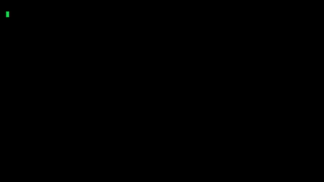

# macOS Matrix Screen Saver

The iconic Matrix digital rain for your Mac.



## Features

- Digital rain, “Wake up, Neo” messages, trace program, and custom command scenes.
- Highly customizable: change the font, characters, speed, density, glow, and scan lines.
- Classic and Resurrections glyph styles, plus personalized intro messages.

## Including animated Wallpaper

Run the animation on your desktop with the included **Matrix Wallpaper** app. Use its menu bar icon to pause, stop, or open **Settings…**.

## Quick install

```bash
brew trust --cask patrickschaper/tap/matrix-screen-saver
brew install --cask patrickschaper/tap/matrix-screen-saver && open "/Applications/Matrix Wallpaper.app"
```

- **Wallpaper:** open **Matrix Wallpaper** in Applications.
- **Screen saver:** select **MatrixScreenSaver** in **System Settings → Wallpaper → Screen Saver**. Choose **Options…** to customize it.

Only use trusted custom commands: they run with the app's permissions, and their text and output are visible even on the lock screen.

## Buy me a coffee

There is no spoon. There is coffee. Donations help cover the Apple Developer membership and ongoing development.

<a href="https://www.buymeacoffee.com/yesman82"></a><br>


## Requirements

- Mac with Apple silicon (M1 or later).
- macOS 15 Sequoia or later.
- Homebrew for the quick install above.

## Development

Want to build or contribute? See the [developer documentation](docs/development.md) for setup, testing, and project details.
