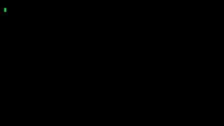

# macOS Matrix Screen Saver and animated Wallpaper



This is a macOS screen saver based on the iconic rain of characters and symbols known from the movie The Matrix.

## Animated Wallpaper
The screen saver also comes with an app replacing your wallpaper with the animation so you can enjoy being in the matrix all the time 🙂.


## Quick install

```bash
brew trust --cask patrickschaper/tap/matrix-screen-saver
brew install --cask patrickschaper/tap/matrix-screen-saver && open /Applications/MatrixWallpaper.app
```

- Wallpaper: open **MatrixWallpaper** in Applications. options available through menubar icon.
- Screen saver options: **System Settings → Wallpaper → Screen Saver → MatrixScreenSaver → Options…**.

## Buy me a coffee

There is no spoon. There is coffee. Donations help cover the Apple Developer membership and ongoing development.

<a href="https://www.buymeacoffee.com/yesman82"></a><br>


## Animation options

The saver exposes a native **Options…** sheet. The values are stored with `ScreenSaverDefaults`.

| Option | Description | Default |
| --- | --- | --- |
| Number scene | Show the startup number scene before continuous rain. | On |
| Twinkle | Turn on/off the twinkling effect. | On |
| Diffuse | Turn on/off the glow effect. | On |
| Character size | Set the character cell width and height in pixels.<br>Example pairs: 8 x 15, 9 x 17, 10 x 19, 11 x 21, 12 x 23, and 13 x 24. | 9 x 17 |
| Rain density | Set the factor for the density of rain drops. A positive number. | 1.0 |
| Frame rate | Set the frame rate per second. A positive number less than or equal to 1000. | 25 |
| Error rate | Set the factor for the rate of character changes. A non-negative number. | 1.0 |
| Characters | Restrict rain glyphs to a custom set (e.g. ATGC). Leave empty for the default. | *(empty)* |
| Fonts | Pick installed fonts for the rain glyphs (up to 8, mixed evenly). Intro text stays in the system font. See [Matrix fonts](#matrix-fonts). | *(system font)* |
| Neo message scene | Show the Neo message intro before the main scene. | On |
| Typing speed | Typing speed multiplier for Neo messages, custom command entry and the trace program. A positive number; pauses keep their natural duration. Output is not typed. | 1.0 |
| Name | Name used in the intro message ("Wake up, {name}..."). Only applies when Neo message lines is empty. | *(empty — uses "Neo")* |
| Neo message lines | Custom lines typed during the Neo message intro, up to 10 lines / 256 characters each. Leave empty to use the Name-based default message instead. | *(empty)* |
| Show custom scene | Animate each command using trace's initial cursor blink, natural typing rhythm and final pause, then clear it and execute it. Uses the general typing speed. Only output is shown afterward, appearing immediately as it arrives from the top row. Full screens scroll upward; wide rows are clipped without wrapping. Each command clears the screen first. Commands use a size-configured terminal with combined stdout/stderr and receive `COLUMNS`, `LINES`, and `stty size`. No keyboard input is provided. Commands run until exit or cancellation, not a fixed 12-second deadline; use `ping -c 100 google.com` for 100 replies. A command that never exits keeps its scene active until stopped. Displayed output is limited to the first 64 KiB; excess output is drained. Configure commands with **Edit…** in **Intro scenes**. Skipped if disabled or empty; the enabled trace program follows. | Off |
| Output hold (seconds) | Keep each command's output visible after it finishes, before the next command or scene. Non-negative seconds; 0 advances immediately. | 10 |
| command playback | Radio buttons select all commands in sequence, one random command, or all commands in random order on each scene entry. Random order runs every command once and reshuffles each cycle; all displays agree on the pick or order. Add, edit, remove, or drag command rows to change their execution order in **Edit…**. Both whole-list modes finish each command and its message playback before running the next. | One random command |
| Scan lines intensity | Opacity of the CRT scan line overlay (0 = off, 100 = fully opaque). | 25 |
| Scan lines vertical | Orientation of the scan line overlay (vertical or horizontal). | On (vertical) |

Custom shell commands execute through `/bin/sh` with the host's permissions.
Only enter commands you trust, and avoid sensitive command text or output: both are visible on the screen saver,
including while the screen is locked. Command text and output are not logged. Live commands run
until exit and retain at most 64 KiB of combined output; stopping or restarting playback
cancels its command. The sandboxed screen saver may not have the same access as the wallpaper app.

### Matrix fonts

The **Fonts** option lists installed fonts that look suited to rain, so the glyphs can match the film. Tick **Show all fonts** to list every family. No fonts are bundled, so install them yourself first.

The free [Matrix Code](https://github.com/Rezmason/matrix/raw/master/assets/Matrix-Code.ttf) and [Matrix Resurrected](https://github.com/Rezmason/matrix/raw/master/assets/Matrix-Resurrected.ttf) fonts are published in [Rezmason/matrix](https://github.com/Rezmason/matrix) (MIT, © Rezmason 2018), which recreate the glyphs from the films. Thanks to Rezmason for making them available.

### Wallpaper menubar menu


## Development

### Current state

- Native Swift/AppKit screen saver bundle
- Edge-to-edge full-screen saver output, with terminal-style chrome kept in the preview host
- In-process renderer for `rain-forever` with an optional upstream `number` intro
- Native **Options…** sheet for Number scene, Twinkle, Diffuse, Character size, Rain density, Frame rate, Error rate, Characters, Fonts, Neo message scene/speed/lines, custom shell commands/playback, and Scan lines
- Preview app for fast iteration without reinstalling

### Repository layout

- `Sources/MatrixScreenSaver/MatrixScreenSaverView.swift` - screen saver view, layout, drawing, and option wiring
- `Sources/MatrixScreenSaver/NativeMatrixRenderer.swift` - native Matrix scene renderer
- `Sources/MatrixScreenSaver/CmdCaptureScene.swift` - streams command output into scrolling terminal rows before the full trace program
- `Sources/MatrixScreenSaver/MatrixScreenSaverOptions.swift` - options model and native configure sheet
- `Sources/MatrixScreenSaver/TerminalSupport.swift` - small shared terminal types used by the active renderer
- `Scripts/install-saver.sh` - shared ditto-based installer used by local installs
- `Tools/PreviewHost.swift` - local preview host used by `./preview.sh`
- `Resources/Info.plist` - bundle metadata

### Requirements

- macOS
- Xcode Command Line Tools with `swiftc`

Full Xcode is not required.

### Build

```bash
./build.sh
./build-wallpaper.sh
```

These create the screen saver bundle and wallpaper app:

```text
build/MatrixScreenSaver.saver
build/MatrixWallpaper.app
```

Both build scripts read the current version from `./VERSION` and write it into their bundle metadata.

Local builds and ordinary CI use ad-hoc signing and do not need Apple credentials.
Only the GitHub release publish job uses Developer ID signing and Apple notarization.

### Test

```bash
./tests.sh
```

Compiles and runs the test suite using `swiftc`. No Xcode required — Command Line Tools are sufficient.

For wallpaper checks, build the app first and run from a logged-in graphical macOS session:

```bash
./wallpaper-tests.sh
./wallpaper-install-tests.sh
```

The UI tests briefly create desktop windows and open Options. Installer tests use a
temporary home directory; neither suite changes your real login items.

### Preview without installing

```bash
./preview.sh
```

This rebuilds the bundle, compiles the preview host, and opens the saver in a normal macOS window for quick iteration.

To launch the built wallpaper app without installing:

```bash
open build/MatrixWallpaper.app
```

### Install

```bash
./install.sh
```

`install.sh`:

1. rebuilds the saver bundle
2. strips quarantine from the source bundle and copies it to `~/Library/Screen Savers/MatrixScreenSaver.saver`
3. verifies the installed executable matches the build output
4. stops running `ScreenSaverEngine` / `legacyScreenSaver` processes so macOS reloads the updated bundle

After installing:

1. open **System Settings > Wallpaper > Screen saver...**
2. select **MatrixScreenSaver**

To relaunch the screen saver host manually:

```bash
open -a ScreenSaverEngine
```

To install and launch the wallpaper app in your user Applications folder:

```bash
./install-wallpaper.sh
open ~/Applications/MatrixWallpaper.app
```

The installer builds and verifies the app, gracefully quits running copies before
replacement, and retains preferences. It does not launch the app or enable login startup.

When MatrixScreenSaver is installed in `~/Library/Screen Savers` or `/Library/Screen Savers`,
the wallpaper menu shows **Sync with Screen Saver**. It is checked by default: the saver
shares the wallpaper's animation. Uncheck it to let the saver animate independently.
The choice survives app restarts and saver reinstallation; opening the menu refreshes
installation detection. This does not change visual options or synchronization between monitors.

While Matrix Wallpaper runs, it saves each display's desktop image and display options,
then sets the underlying wallpaper to plain black. **Stop** and **Quit Matrix Wallpaper**
restore those settings. Temporary pauses and animation restarts keep the original backup.
If you choose a different wallpaper while Matrix runs, that newer choice is preserved.

Backups are stored in `~/Library/Application Support/MatrixWallpaper/DesktopWallpaper/`.
After a crash or force-quit, reopen Matrix Wallpaper and choose **Stop** to restore the desktop.
Disconnected displays and failed restores keep their backups for a later retry.
Exact restoration is supported for static images; macOS's public API cannot preserve every
dynamic/aerial wallpaper, rotating collection, or separate Space configuration.

### Origin

This project started as an attempt to wrap `cxxmatrix` inside a macOS screen saver.

The current implementation is based on the upstream [`akinomyoga/cxxmatrix`](https://github.com/akinomyoga/cxxmatrix) project and keeps its look and scene behavior, but it no longer launches an external terminal process at runtime. The active saver is a native in-process Swift/AppKit renderer because `ScreenSaverEngine` did not reliably render the external terminal stream.

The active renderer currently ports `rain-forever` and can optionally start with the upstream `number` intro.
