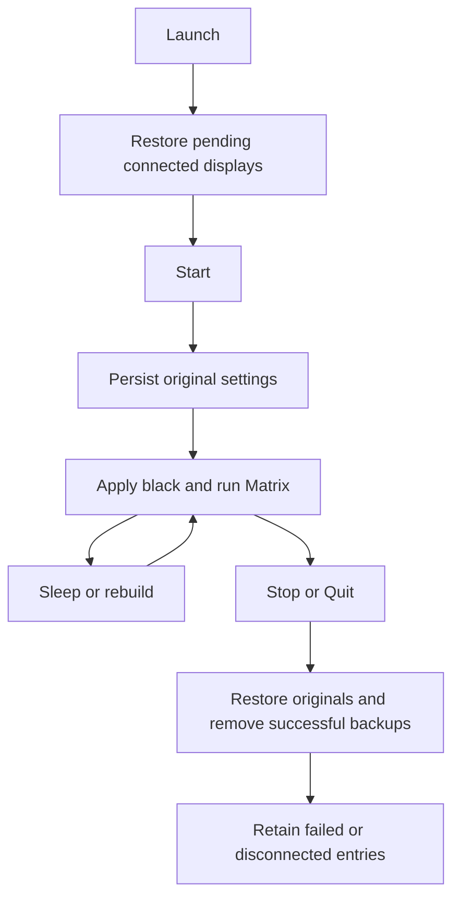

# Restore Desktop Wallpaper - Plan

## Goal Capsule

Users see a black desktop behind Matrix Wallpaper and regain their previous wallpaper when they stop or quit it.
Use the native desktop-image API with a durable per-display backup (KTD1).
Implement and verify locally; commits and publication require separate user instruction.
Requirements govern behavior; technical decisions govern implementation within those requirements.
Stop if the original settings cannot be preserved before mutation.

## Product Contract

### Summary

Save each display's wallpaper before applying black, and restore it on Stop or Quit.
Recover interrupted sessions on the next launch.

### Problem Frame

Matrix Wallpaper currently manages desktop-level windows but leaves the underlying desktop image in place.
The user wants black behind the animation without permanently losing their wallpaper choice.

### Requirements

- R1. Before applying black, persist the current image URL and native display options for each connected display.
- R2. Restore saved settings on explicit Stop and normal Quit; temporary suspension and animation rebuilds retain the backup.
- R3. Recover saved settings after an interrupted session on the next launch; retain disconnected displays and failed restores for later retry.
- R4. Never replace an original backup with the app's black image, and preserve a wallpaper the user explicitly changes while Matrix is running.
- R5. Failed backup or unreadable settings leave the affected wallpaper untouched and report the failure.

### Scope Boundaries

Static image wallpapers are the supported round-trip case.
Public APIs cannot promise exact restoration of dynamic/aerial selections, rotating collections, or separate Space configurations.
Immediate recovery after force-quit would require another process and is outside this change.

## Planning Contract

### Key Technical Decisions

- KTD1. Use a wallpaper-only controller with an atomic backup file under Application Support and stable display UUIDs. Persist options using secure Foundation archiving so native colors and scaling survive a relaunch.
- KTD2. Keep backup ownership at the app playback level, outside window cleanup: `removeDesktopWindows` also runs for ordinary renderer rebuilds.
- KTD3. Inject desktop read/write operations, following `LoginItemController`'s testing pattern, so app tests never change real user wallpaper.
- KTD4. Restore only while the desktop still points to the app-owned black image; a different image means the user's newer choice wins (R4).
  Repeated begin/rebuild calls within a playback session must not reapply black over that newer choice. A new Start captures current non-black settings rather than reusing a stale original.

### Lifecycle

## Implementation Units

### U1. Durable desktop-image ownership

**Requirements:** R1, R3, R4, R5. **Dependencies:** none.
**Files:** `Sources/MatrixWallpaper/DesktopWallpaperController.swift`, `Tests/MatrixWallpaperTests/DesktopWallpaperTests.swift`, `wallpaper-tests.sh`, `build-wallpaper.sh`, `Tests/MatrixWallpaperTests/main.swift`.
**Approach:** Implement KTD1, KTD3, and KTD4, generate a tiny black PNG in Application Support, and expose begin/restore operations.
**Patterns:** Injectable system operations in `Sources/MatrixWallpaper/LoginItemController.swift`; AppKit checks in the wallpaper test harness.
**Test scenarios:**
- Two displays with different URLs and options round-trip through black and back.
- A fresh controller recovers the on-disk backup after simulated process loss.
- Repeated begin calls while the app-owned black image remains selected preserve the first backup.
- Disconnected displays and failed writes retain recoverable originals.
- Corrupt or unwritable backup storage prevents wallpaper mutation.
- A user-selected replacement survives rebuilds and Stop; a later Start/Stop restores that replacement even if an older restore entry remains.
**Verification:** Tests exercise real file persistence with fake desktop operations and inspect the generated PNG.

### U2. App lifecycle and documentation

**Requirements:** R1-R5. **Dependencies:** U1.
**Files:** `Sources/MatrixWallpaper/WallpaperApp.swift`, `Tests/MatrixWallpaperTests/WallpaperAppTests.swift`, `Tests/MatrixWallpaperTests/LoginItemTests.swift`, `README.md`.
**Approach:** Implement KTD2; restore stale backups on launch, apply black when playback starts, and restore on Stop/Quit and stopped display reconnection. Report errors through the native app and retain backups.
**Test scenarios:**
- Launch and Start apply black; Stop and Quit restore.
- Sleep/wake, screen-saver suspension, and options/display reconstruction preserve ownership.
- Existing menu and login tests use isolated wallpaper operations.
**Verification:** Existing app lifecycle assertions plus wallpaper state assertions pass; the app and saver build successfully.

## Verification Contract

Run `./wallpaper-tests.sh`, `./tests.sh`, `./build-wallpaper.sh`, and `./build.sh`.
Wallpaper operations in automated tests use temporary storage and fake desktop state.
Report actual desktop/Spaces behavior as unverified unless separately exercised.

## Definition of Done

Both units satisfy their scenarios, required checks pass, documentation states restoration limits, and abandoned experimental code is removed.
Leave the resulting changes uncommitted on the authorized feature branch.
