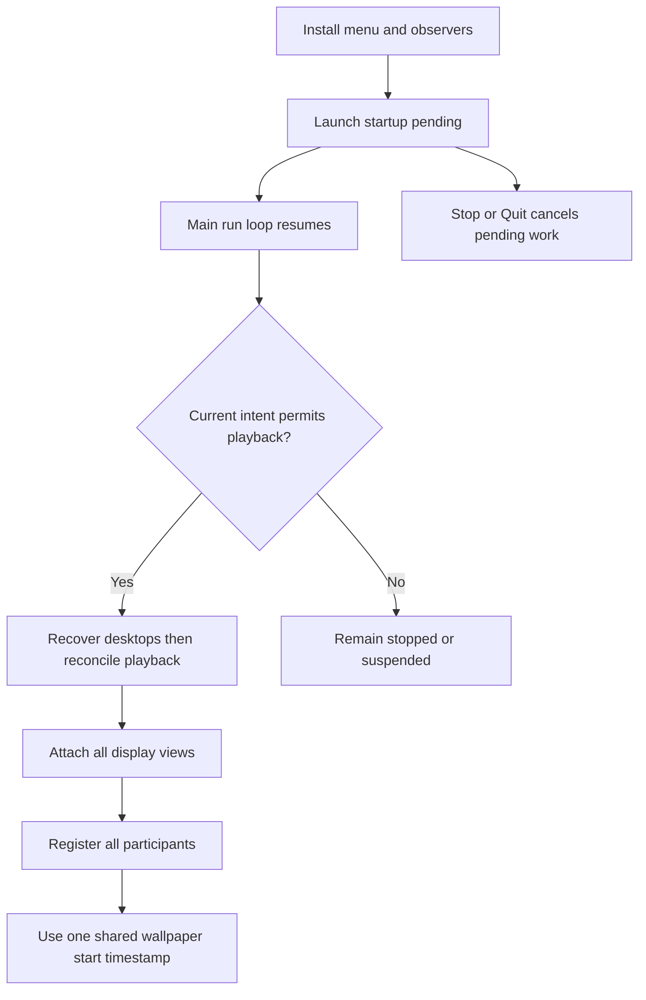

# Wallpaper Startup Optimization - Plan

## Goal Capsule

- **Objective:** Show Matrix Wallpaper's menu promptly and begin animation sooner after launch or Start.
- **Means:** Per-view glyph reuse, deferred launch playback, and a wallpaper-specific startup delay (KTD1–KTD3).
- **Authority:** The user request and R1–R5 govern behavior; KTDs govern implementation within those constraints.
- **Execution:** Implement and verify locally on the current branch. The parent session owns completion; branch creation, commits, pushes, PRs, and workflow runs require separate permission.
- **Stop conditions:** Report any change that would weaken desktop restoration, Stop/Quit behavior, or synchronization guarantees rather than silently expanding scope.

## Product Contract

### Summary

Remove repeated glyph rasterization during unchanged layout passes, return from app launch before starting playback, and shorten only wallpaper startup coordination.

### Problem Frame

On three displays, the supplied release (`-O`) profile measured a 1091–1133 ms launch callback and a 1049–1059 ms menu Start action. Fifteen synchronous glyph-cache builds consumed 1033–1062 ms at launch and 1026–1033 ms on Start. Eighteen overall builds cost roughly 1231–1273 ms. The status item was created at 25–32 ms, but actual menu presentation was not measured. Coordination adds a fixed one-second startup delay.

The profile uses real views and windows with simulated desktop setters. It excludes Launch Services, dyld startup, and real desktop-image mutation; these numbers are not end-to-end launch measurements.

### Requirements

**Rendering**

- R1. Reuse each view's glyph images while their rasterization inputs remain unchanged; invalidate for cell dimensions, fonts, text placement, palette, supported scalars, or released resources.
- R2. Preserve visual output and existing grid, frame-buffer, dirty-row, and options behavior across layout, resize, stop/start, and configuration changes.

**Lifecycle and synchronization**

- R3. Install menu controls and yield the launch callback before expensive playback creation; queued startup must honor current Stop, Quit, and suspension state.
- R4. Reduce wallpaper-only initial coordination delay while preserving the default screensaver delay, shared start/content timestamps, registration timeout, restart barriers, and phase transitions.
- R5. Preserve desktop recovery before acquiring wallpaper ownership, restoration on Stop/Quit, and shared-frame producer/consumer behavior.

### Scope Boundaries

- Per-view reuse is the first optimization; cross-view/global caches are deferred unless the measured result shows this scope is insufficient.
- No new user preference, dependency, background AppKit rendering, or changes to desktop backup formats.
- Permanent profiling infrastructure is unnecessary for this change; retain benchmark results in the completion report.

## Planning Contract

### Key Technical Decisions

- KTD1. **Guard the existing glyph-cache builder with a per-view signature.** `MatrixScreenSaverView.updateLayout` currently rebuilds both font caches on every call, including initialization, attachment, and animation startup. Compare effective raster inputs rather than all saver options or window bounds. Include cell width/height, regular and bold font identity/size, `textInsetY`, ordered palette values, and `supportedScalars`. Clear the signature whenever `releaseRenderingResources` clears images. This preserves R1–R2 without introducing shared ownership.
- KTD2. **Defer launch playback on the main run loop and keep reconciliation authoritative.** Schedule one cancellable launch continuation after menu setup. Check termination and current playback state before it can restore/acquire desktops or create views. Reconciliation entry points must not bypass pending launch deferral through screen notifications, options, or frame requests. Stop and Quit invalidate pending work; a subsequent explicit Start remains valid. Preserve recovery-before-acquisition ordering (R3, R5).
- KTD3. **Make initial delay session-specific, not a mutable global default.** Allow registration to select a startup delay with the existing one-second default. The wallpaper host opts into the shorter value. Capture it for the session, use it for both all-ready and registration-timeout resolution, and clear it at session teardown/testing reset. Leave restart delay and phase-advance behavior on their existing constants (R4).

### Assumptions

- A zero-second wallpaper initial delay is the starting choice to validate: `WallpaperApp.reconcilePlayback` attaches every display before starting any animation timer. All participants must still receive one shared timestamp, never independent immediate starts.
- Initial release-profile targets are at most one glyph-cache build per view for unchanged inputs, at least 50% lower menu Start action time, and a launch callback below 100 ms in the same simulated-setter harness. These are implementation gates, not previously measured guarantees.
- Yielding one main-run-loop turn gives AppKit an opportunity to present the menu; it does not prove the status item was painted. Confirm presentation separately on macOS and adjust scheduling only if that evidence requires it.

### High-Level Technical Design

## Implementation Units

### U1. Reuse unchanged per-view glyph images

**Goal:** Eliminate redundant rasterization. **Requirements:** R1, R2. **Dependencies:** None.

**Files:** `Sources/MatrixScreenSaver/MatrixScreenSaverView.swift`; add `Tests/MatrixWallpaperTests/GlyphCacheTests.swift` and wire it into `Tests/MatrixWallpaperTests/main.swift` and `wallpaper-tests.sh`.

**Approach:** Apply KTD1 at the cache builder, retaining layout and frame-buffer work. Follow the existing `rebuildNativeFrameContext` reuse guard and wallpaper test inspection helpers. Prefer comparing cached image identities or a small test seam over permanent timing counters. Do not extend the signature to settings that do not affect glyph images.

**Test scenarios:**
1. Construct a real view, repeat layout/attachment/start with unchanged inputs, and verify glyph-image identity is retained.
2. Resize only window bounds: grid/frame buffer updates while glyph images remain reusable.
3. Change character width and height independently, palette colors, and a glyph pool containing an additional scalar: images rebuild and the new scalar is available.
4. Change font or text placement inputs through the smallest suitable test seam: the signature invalidates; unchanged equivalent inputs compare equal.
5. Release rendering resources, then restart with the same options: caches regenerate instead of remaining empty.

**Verification:** AppKit cache tests pass and the release profile shows at most one cache build per view for unchanged raster inputs.

### U2. Yield launch startup and cancel stale work

**Goal:** Let menu setup finish before playback creation. **Requirements:** R3, R5. **Dependencies:** None; implement after U1 to simplify profiling attribution.

**Files:** `Sources/MatrixWallpaper/WallpaperApp.swift`; `Tests/MatrixWallpaperTests/WallpaperAppTests.swift`.

**Approach:** Apply KTD2 using the existing playback state and desktop-controller fixture. Audit every `reconcilePlayback` caller and the termination path. Update synchronous launch assertions to distinguish menu-ready from playback-ready, using the existing `eventually`/run-loop helpers instead of arbitrary sleeps. Keep menu Start semantics unless measurement proves a separate change necessary.

**Test scenarios:**
1. Immediately after launch returns, the status item/menu exists and no playback windows or black-desktop acquisition have occurred; draining queued work starts one coordinated session.
2. Stop before queued startup runs, then drain it: no windows, registration, or black-desktop acquisition occurs.
3. Quit before queued startup runs, then drain it: no windows or desktop reacquisition occurs and observers remain removed.
4. Stop then explicit Start before stale work drains: exactly one current session starts; stale work cannot duplicate or undo it.
5. Sleep/session suspension, display notifications, options, and frame requests during pending launch cannot bypass deferral; resume uses current intent and geometry.
6. Existing stale-backup recovery and termination-recovery tests still prove recovery-before-acquisition and preserved retry data.

**Verification:** Lifecycle tests pass, the release launch callback meets the assumed gate, and a real app launch shows the menu before animation setup completes.

### U3. Shorten wallpaper startup coordination only

**Goal:** Remove the wallpaper's fixed startup wait without splitting display timelines. **Requirements:** R4, R5. **Dependencies:** U1 and U2 for final benchmark comparison; coordinator logic is independently testable.

**Files:** `Sources/MatrixScreenSaver/ScreenSyncCoordinator.swift`; `Sources/MatrixScreenSaver/MatrixScreenSaverView.swift`; `Tests/MatrixScreenSaverTests/ScreenSyncCoordinatorTests.swift`; `Tests/MatrixWallpaperTests/WallpaperAppTests.swift`.

**Approach:** Apply KTD3 at `startNativeRenderer` registration. Keep ordinary callers source-compatible and the wallpaper opt-in explicit. Preserve excluded-participant handling and timeline shifting. Document that the delay is initial-start-only.

**Test scenarios:**
1. Default registration still resolves one second after readiness; wallpaper registration uses the shorter session delay.
2. Multiple participants get no start before the expected group is ready, then receive identical start/content timestamps.
3. Registration-timeout fallback uses the selected initial delay; exclusion/unregistration still allows the remaining group to resolve correctly.
4. After all participants unregister or the test coordinator resets, a default session does not inherit the wallpaper delay.
5. A wallpaper session's rain restart retains the existing one-second delay; phase barriers and pause-shifted playback clocks retain their behavior.
6. Real wallpaper views select the fast path, and saver consumer/fallback tests preserve their current startup behavior.

**Verification:** Coordinator tests, app integration tests, and multi-display first-animation inspection agree on one shared timeline.

## Verification Contract

- Run `./tests.sh`, then `./wallpaper-tests.sh` sequentially: their shared transport interferes when run in parallel.
- Build both deliverables with `./build.sh` and `./build-wallpaper.sh`.
- Repeat the supplied `startup-profile` scratch benchmark with release `-O`, the same three displays, options, simulated setters, and measurement boundaries. Retain at least three runs, reporting ranges for launch return, menu Start, glyph-build count/time, and first animated frame separately. The parent session retains the external harness location.
- Compare against the Problem Frame baseline and Assumptions gates. Measure total time through playback so deferral cannot disguise unchanged work as a speedup. If a gate misses, identify the remaining cost before considering the deferred global cache.
- Smoke-check actual menu presentation, Start/Stop/Quit, visual glyph correctness, three-display synchronization, resize/options, and sleep/resume on macOS. Report any unavailable real-desktop check explicitly; the simulated-setter benchmark cannot establish it.

## Definition of Done

R1–R5 have the listed regression coverage, both suites and builds pass, and the same-harness benchmark meets the stated gates. A missed gate or unavailable required check is an unresolved verification gap, not completion. Actual menu presentation is distinguished from status-item creation and launch-return timing. Remove abandoned experiments and temporary production instrumentation. Keep the final changes local for user review.
