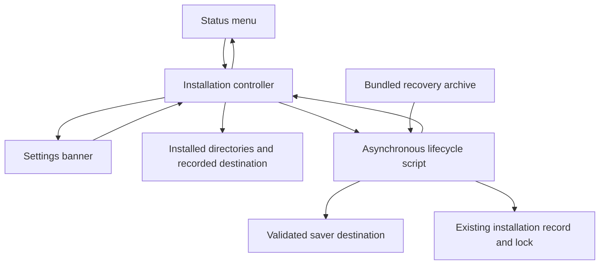
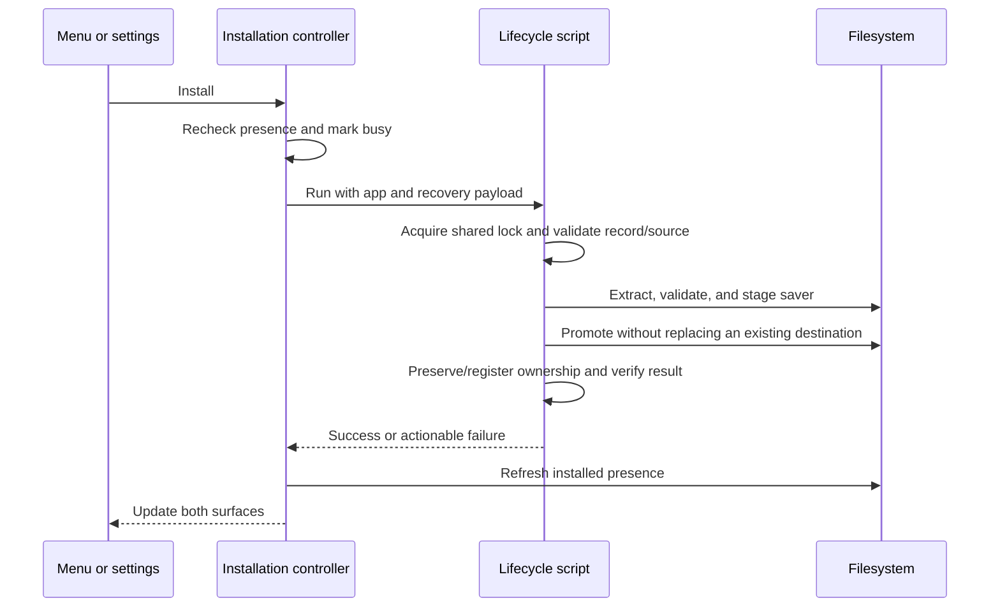

# Install Missing Screen Saver - Plan

## Goal Capsule

Make a missing Matrix screen saver recoverable from Matrix Wallpaper, including after deletion in System Settings.
Replace the unavailable sync action with an install action, show a concise settings banner, and make both install controls restore the saver through one implementation.

This document plans the work; it does not authorize implementation, branch creation, commits, pushes, workflow runs, or installation on the developer's Mac.
Implementation must follow the repository's native Swift/AppKit architecture and existing installation safeguards.

---

## Product Contract

### Summary

Matrix Wallpaper should explain when its companion screen saver is missing and let the user reinstall it without leaving the app or losing settings.

### Problem Frame

Deleting the saver leaves the wallpaper application running, but the current menu hides the sync item and offers no recovery action.
The settings window still describes shared settings without indicating that the saver is absent.
The current installer replaces the entire app/saver pair and quits the wallpaper app, so it cannot directly serve an in-app recovery button.

### Requirements

**Menu and settings**

- R1. When MatrixScreenSaver is absent, show **Install Screen Saver** in the menu position currently occupied by **Sync with Screen Saver**. The install action has no checkmark.
- R2. When the saver is installed, show the existing sync toggle with its saved on/off value. Deletion and reinstallation must not reset that value.
- R3. In the wallpaper app's settings window, show **“Screen saver isn’t installed.”** and an **Install Screen Saver** button while it is missing. Hide the banner when it is installed.
- R4. Refresh presence when the menu opens, when settings opens or becomes active again, and after installation completes. Deletion in System Settings must be reflected without relaunching Matrix Wallpaper.

**Installation and recovery**

- R5. Both entry points use the same install operation. Reinstallation must work after the original download or installer folder has been removed.
- R6. While installing, display **Installing Screen Saver…** and disable both install controls. Prevent duplicate operations, keep the interface responsive, and leave the wallpaper running.
- R7. Success restores the sync item and removes the banner only after the installed bundle is verified. Failure leaves installation available for retry and shows a concise error explaining the next action.
- R8. Preserve rendering options, sync preference, wallpaper playback/pause state, login-item registration, existing installation ownership, and unrelated files.

### Assumptions and Scope Boundaries

These are proposed defaults where the request did not specify behavior:

- “Options panel” means Matrix Wallpaper's **Settings…** window. The same controller also serves the actual screen saver and preview host; they should not acquire an installer banner.
- Installation is an explicit user action. Do not automatically reinstall something the user deleted.
- Reinstallation restores availability; it does not select MatrixScreenSaver as the active macOS screen saver or change lock-screen settings.
- Use the app's matching bundled saver, with no runtime download, updater, administrator helper, or dependency on an installed Homebrew executable.
- An existing managed installation retains its recorded destination. A previously unmanaged app installs to the current user's `Library/Screen Savers` and registers the pair using the existing local ownership model.
- A protected destination produces an actionable permissions error; this feature does not introduce privilege escalation or silently create a second installation elsewhere.
- Live filesystem watching is unnecessary for this scope. Refresh on the interaction boundaries in R4 and immediately before an install action; an inactive settings window may refresh when focus returns.
- A valid installed saver with another version still counts as installed. Version upgrades and general repair of corrupt/conflicting bundles are outside this feature.

### Acceptance Examples

| ID  | Situation                                                         | Expected result                                                                                         |
| --- | ----------------------------------------------------------------- | ------------------------------------------------------------------------------------------------------- |
| AE1 | Delete the saver in System Settings, then open the Matrix menu    | Install action replaces sync; no checkmark (R1, R4).                                                    |
| AE2 | Open Settings while no saver exists                               | One compact banner appears above the settings tabs (R3).                                                |
| AE3 | Install from either surface                                       | Both controls become busy; wallpaper keeps running; verified completion hides the banner (R5–R7).       |
| AE4 | Disable sync, delete, then reinstall the saver                    | Sync returns unchecked and all rendering settings remain intact (R2, R8).                               |
| AE5 | Another process installs the saver before the user clicks Install | Recheck presence and refresh the UI without replacing that installation (R4, R8).                       |
| AE6 | Copy, validation, permissions, or registration fails              | No partial installation is presented as success; error allows retry and preserves prior state (R7, R8). |
| AE7 | Saver exists under a renamed bundle or in the system directory    | Existing discovery semantics continue to expose Sync (R2).                                              |

---

## Planning Contract

### Repository Findings

- `Sources/MatrixWallpaper/WallpaperApp.swift`: `menuWillOpen` scans the user and system `Screen Savers` directories, reads bundle metadata directly, and hides `syncItem` when the identifier is absent. It deliberately preserves the `syncWithScreenSaver` preference. There is no in-app install action.
- `Tests/MatrixWallpaperTests/WallpaperAppTests.swift`: `wallpaperSyncMenuTests` already covers missing, renamed, unrelated, malformed, system-directory, and symlinked saver bundles, plus preference persistence. Update these tests instead of replacing that coverage.
- `Sources/MatrixScreenSaver/MatrixScreenSaverOptions.swift`: the shared options controller has an `onApply` callback, retained window, root stack, scrollable tab content, and `sizeWindowToFitContent`. It has no host installation context or banner.
- `build-wallpaper.sh`: packages fonts and artwork, but no saver recovery payload or lifecycle script.
- `Scripts/product-lifecycle.sh`: owns bundle validation, installation records, local/Homebrew ownership, shared locking, staging/rollback, cleanup registration, and removal. Its `install_pair` operation quits and replaces the app as well as the saver. `Scripts/install-saver.sh` is only a compatibility entry point to pair installation.
- `Homebrew/Casks/matrix-screen-saver.rb`: records the configured saver destination and `homebrew` ownership. Recovery must respect that record, including a custom directory.
- `.github/workflows/release.yml`, `Scripts/sign-bundle.sh`, and `Scripts/notarize.sh`: currently build and sign the two bundles, submit them together, staple them, and package a combined release. A self-contained recovery payload changes this ordering.

### Key Technical Decisions

- KTD1. **One wallpaper-owned installation controller.** Add a small `ScreenSaverInstallationController` to own presence discovery, in-flight state, and asynchronous process completion. Both menu and settings observe its state. Retain injectable directories and add an injectable operation boundary for isolated tests; do not introduce a general installer framework.
- KTD2. **Preserve presence detection semantics.** Continue direct plist reads by bundle identifier, including renamed bundles and resolvable symlinks in the existing two directories. Also check the validated recorded saver destination so Homebrew custom locations do not appear missing. Do not count the app's recovery payload as an installation. Validate signatures and matching versions during installation, not on every menu opening.
- KTD3. **Extend the existing lifecycle script.** Add a dedicated `install-saver` operation that uses the same lock, safe-path checks, validation, and registration model. It must not call `install_pair`, quit Matrix Wallpaper, replace the app, or re-register the login item. Invoke `/bin/bash` with separate process arguments, never an interpolated shell command. Ship the current script in app resources so recovery does not depend on an older installed copy.
- KTD4. **Bundle an immutable recovery archive.** Store the same-version saver as `Contents/Resources/ScreenSaver/MatrixScreenSaver.zip`, alongside the lifecycle script. Extract into private staging, validate the resulting bundle, and copy/promote to the selected destination. An archive avoids modifying nested executable resources inside a signed app during release ticket stapling.
- KTD5. **Prepare the recovery payload before final app signing.** For releases, sign, notarize, and staple the standalone saver first; create its recovery archive; then assemble/sign/notarize/staple the wallpaper app. Keep the standalone saver in the release ZIP for existing installers and Homebrew. Reuse the notarization helper with explicit bundle inputs rather than duplicating its error handling. Local builds use the current ad-hoc signed saver and require no Apple credentials.
- KTD6. **Keep installer concerns out of the shared options model.** Add a default-disabled banner presentation API and install callback to the options controller. WallpaperApp supplies them; saver and preview callers retain current behavior. No installation state is persisted in rendering defaults.
- KTD7. **Use interaction-driven refresh.** Refresh one controller at menu opening, settings presentation/reactivation, app activation, and install completion. Recheck at action time. Pair notification subscriptions with existing cleanup and weak captures so closing settings or quitting during completion cannot reopen a window.

### High-Level Technical Design

The following sketches describe responsibilities and transitions, not prescribed Swift APIs.

| State      | Menu                               | Settings banner                    | Transition                                                               |
| ---------- | ---------------------------------- | ---------------------------------- | ------------------------------------------------------------------------ |
| Installed  | Sync toggle with saved checkmark   | Hidden                             | Refresh finds removal → missing                                          |
| Missing    | Install Screen Saver, unchecked    | Message and enabled install button | Click and recheck → installing, or installed if already restored         |
| Installing | Installing Screen Saver…, disabled | Busy text and disabled button      | Verified completion → installed; failure → refreshed presence plus error |

Failure is a result reported to the user, not a persistent fourth presence state.
An error should be presented as a sheet on an open settings window, or an ordinary app alert from the menu; do not force Settings open.
Preserve unsaved settings edits while updating the banner, and do not make installation the window's Return-key default action.

### Installation Transaction Rules

These rules refine KTD3 and govern all callers:

1. Validate the invoking app identity, source saver identity/signature, and matching bundle versions. Validate the embedded archive layout and reject unexpected paths or symlink escapes before accepting extracted content.
2. If a record exists, validate its app path against the invoking app, preserve its `owner`, and use its saver destination. Refuse conflicting ownership records rather than silently adopting another installation. If no record exists, use the user's standard saver path and create local cleanup registration only after successful staging.
3. Acquire the existing installation lock before changing destination or registration state. Recheck the target under the lock. If a matching valid saver already occupies it, return an idempotent success; never downgrade or overwrite it as part of recovery. A conflicting directory, file, or broken symlink produces an error without deletion.
4. Create staging on the destination filesystem, preserve bundle metadata using the existing `ditto` approach, and validate the staged bundle before promotion. Promotion must fail if another process has occupied the destination; a plain move that can nest a bundle inside an existing directory is insufficient.
5. Preserve an existing valid record and cleanup job. For a new registration, include record/job changes in rollback. Do not leave a restored saver outside the removal lifecycle, or change `homebrew` ownership to `local`.
6. Clean up only this operation's staging and artifacts. If rollback cannot finish, preserve recovery material and report its path. Leave preferences and the running app untouched. Do not signal screen saver host processes merely to restore a missing bundle.
7. Report success only after destination validation and required registration succeed. Refresh UI from the actual filesystem even after an error; another installer may have completed independently.

### Sequencing and Delivery

Implement U1, U2, U3, then U4 in one coordinated feature change, with U5 verification across the completed path.
Do not ship an install button before the recovery payload and transaction exist.
No dependency additions or preference migration are needed.

---

## Implementation Units

### U1. Add a saver-only installation transaction

**Covers:** R5, R7, R8; KTD3 and the transaction rules.

**Files:** `Scripts/product-lifecycle.sh`, `Tests/Installation/lifecycle_test.py`, `Tests/Homebrew/cask_lifecycle_test.rb`, `Tests/Homebrew/support/integration_driver.rb` where real Homebrew coverage is applicable.

Extend the script's action dispatch and usage with `install-saver`, retaining the existing pair installer unchanged in behavior.
Reuse validation, record, locking, and registration helpers without a broad installer refactor.
Add failure injection to the existing isolated lifecycle fixtures before wiring the UI.

**Test scenarios:**

- Install pair, delete saver, restore it: app inode, preferences, owner, destination, and login registration remain unchanged; no quit request is made.
- Restore with a `homebrew` record and custom writable saver directory: ownership and path survive; subsequent uninstall/cleanup still addresses the restored saver.
- No record: restore to the user directory, register the current app/saver pair, and verify later app-removal cleanup.
- Missing/corrupt payload, identifier/version mismatch, invalid signature, unsafe archive path, and source symlink escape: fail before destination changes.
- Busy lock, permission failure, conflicting target, broken symlink, and target appearing during promotion: preserve existing files and return a useful error.
- Copy, verification, promotion, and registration failure: no false success, rollback only owned changes, retain recoverable staging if cleanup fails.
- Repeated install request after successful restoration: no replacement and no preference change.

### U2. Package a recovery payload in development and release builds

**Covers:** R5, R8; KTD4, KTD5.

**Files:** `build-wallpaper.sh`, `Scripts/notarize.sh`, `Scripts/sign-bundle.sh` if its interface needs adjustment, `.github/workflows/release.yml`, `.github/workflows/tests.yml`, `Tests/Signing/signing_test.py`, `wallpaper-install-tests.sh`, `Scripts/render-homebrew-release.py`, `Tests/Homebrew/release_metadata_test.py`, and `Tests/Homebrew/fixtures/release_fixture.py` if archive expectations change.

Ensure a fresh standalone `build-wallpaper.sh` invocation produces or deliberately receives a current saver payload; never silently package an old `build/` artifact just because it exists.
Provide a narrow build-script input for the prepared release saver so building the app cannot overwrite its Developer ID signature or stapled ticket with an ad-hoc rebuild.
Package the script and saver archive before signing the app.
Adjust release ordering per KTD5, retaining explicit failure propagation and existing release asset layout.

**Test scenarios:**

- Clean development build includes the archive and script; extracted saver identity and both version fields match the app.
- A stale existing saver build cannot silently enter a newer app.
- Release fixtures prove saver signing/notarization/stapling precedes archive creation and final app signing; failures stop packaging without fallback signing.
- Installation still succeeds after removing the original release extraction directory.
- Validate final app signature after payload assembly, and extracted saver signature/ticket separately.
- Existing combined installer and Homebrew archive validation accept the enlarged app without changing top-level assets. Measure the archive against the existing 100 MB validation limit; do not raise it without evidence.

**Execution note:** Stubbed signing tests establish command sequencing only. A real signed release artifact must later prove offline recovery under Gatekeeper; do not claim stubs provide that evidence.

### U3. Share presence state and replace the menu action

**Covers:** R1, R2, R4–R8; KTD1–KTD3, KTD7.

**Files:** new `Sources/MatrixWallpaper/ScreenSaverInstallationController.swift`, `Sources/MatrixWallpaper/WallpaperApp.swift`, `Tests/MatrixWallpaperTests/WallpaperAppTests.swift`, new `Tests/MatrixWallpaperTests/ScreenSaverInstallationTests.swift`, `Tests/MatrixWallpaperTests/main.swift`, `build-wallpaper.sh`, `wallpaper-tests.sh`.

Move existing discovery into the controller and route the menu's label, action, enabled state, and checkmark through one refresh function.
Dispatch installation off the main thread using `Process`, consume output without pipe deadlock, and deliver bounded errors/completion on the main thread.
Keep a child operation alive through completion; do not terminate it halfway through a filesystem transaction if the app quits. Completion must respect `isTerminating`.
Do not change the frame-sharing preference or playback reducer when availability changes.

**Test scenarios:**

- Replace existing “hidden without saver” expectations with visible Install/action/no-checkmark assertions.
- Preserve renamed, system-wide, malformed, unrelated, and resolvable-symlink discovery cases; add missing directories and a recorded custom destination.
- Sync off → delete → install → sync off, including app relaunch.
- Menu-triggered installation uses the shared operation once; repeated clicks while busy do nothing.
- Already-installed-at-click refreshes without launching the installer.
- Async failure re-enables the action; success without discoverable verified output is not shown as installed.
- Quit during installation cannot recreate windows, change playback, or present a late alert.

New wallpaper-only source files belong in `build-wallpaper.sh` and `wallpaper-tests.sh`, not the saver build's source list. Continue to compile the shared options file in both products.

### U4. Add the compact settings banner

**Covers:** R3, R4, R6–R8; KTD6, KTD7.

**Files:** `Sources/MatrixScreenSaver/MatrixScreenSaverOptions.swift`, `Sources/MatrixWallpaper/WallpaperApp.swift`, `Tests/MatrixWallpaperTests/WallpaperAppTests.swift`.

Add one native banner row above `optionsScrollView`, outside the tabs so it remains visible on every tab.
Use wrapping secondary text, a standard push button, native semantic colors, and normal keyboard/VoiceOver behavior.
Hide the whole row when unavailable to the host or when the saver is installed, reclaiming its layout space.
Reuse `sizeWindowToFitContent` so Save/Cancel remain accessible on short screens.

WallpaperApp supplies the install callback and current presentation state on first creation, reuse, focus return, and installer completion.
Updating the banner must not call `prepare(using:)` again or reset any unsaved field, selected tab, or editor state.
Keep default construction compatible with saver and preview call sites.

**Test scenarios:**

- Missing saver: banner text and install button appear; installed saver: row is absent with no empty gap.
- Banner button invokes the same operation as the menu; both reflect busy and completion together.
- Delete/restore externally while settings is open, then refocus: presentation updates without losing unsaved edits.
- Installation failure leaves the banner and offers retry; closing the window during install is safe.
- Controller constructed without wallpaper context never shows the banner.
- Verify focus order, non-default install action, VoiceOver labels, light/dark appearance, and short-screen layout manually.

### U5. Verify the complete recovery flow and document it

**Covers:** R1–R8 and AE1–AE7.

**Files:** `README.md` for concise end-user recovery instructions, `docs/development.md` for payload/build/test mechanics, existing test runners and CI only where required by U1–U4.

Document the menu and settings recovery controls and explain that installation does not select the saver in System Settings.
Keep implementation details in the developer documentation.
Review all new or changed declarations against the project Swift documentation rules and global code-commenting skill during implementation.

Use an isolated account or VM for deletion and managed-installation checks; do not mutate the developer's real saver installation as a routine automated test.

---

## Verification Contract

These checks are planned, not executed by this planning task.

| Check                                                                                              | Scope                     | Required evidence                                                                                                                                                   |
| -------------------------------------------------------------------------------------------------- | ------------------------- | ------------------------------------------------------------------------------------------------------------------------------------------------------------------- |
| `python3 Tests/Installation/lifecycle_test.py`                                                     | U1                        | Restoration, ownership, locking, collision handling, rollback, and cleanup pass in isolated HOME.                                                                   |
| `python3 Tests/Signing/signing_test.py`                                                            | U2                        | Updated release sequence and failure propagation pass with stubbed Apple tools.                                                                                     |
| `./build.sh` and `./build-wallpaper.sh`                                                            | U2–U4                     | Both native products compile; packaged payload matches the app.                                                                                                     |
| `./tests.sh`                                                                                       | Shared saver/options code | Existing saver tests pass.                                                                                                                                          |
| `./wallpaper-tests.sh`                                                                             | U3–U4                     | Presence transitions, actions, banner, preference preservation, and existing wallpaper tests pass.                                                                  |
| `./wallpaper-install-tests.sh`                                                                     | U1–U2                     | Existing pair installation and recovery packaging remain compatible.                                                                                                |
| `ruby Tests/Homebrew/cask_lifecycle_test.rb` and `python3 Tests/Homebrew/release_metadata_test.py` | U1–U2                     | Cask lifecycle and archive/build-order expectations remain compatible.                                                                                              |
| `bash Tests/Homebrew/integration_lifecycle.sh`                                                     | U1–U2                     | Isolated real Homebrew restore followed by upgrade/uninstall preserves owner/path and artifact lifecycle on supported ARM64 macOS.                                  |
| Manual AppKit walkthrough                                                                          | U3–U5                     | Both entry points, focus refresh, errors, accessibility, and small-display layout behave as specified.                                                              |
| Signed release-artifact check in isolated macOS                                                    | U2, U5                    | Remove download folder, delete installed saver, disconnect network, restore from installed app, and run saver successfully; app and saver validation remain intact. |

For manual coverage, test sync initially on and off, wallpaper playing/paused/stopped, removal through System Settings, external reinstallation, and failure followed by retry.
Do not trigger a release workflow merely to perform local verification. Coordinate real Developer ID/notarization verification within an explicitly authorized release or signing session.

### Risks and Execution-Time Checks

- **Packaging order:** The recovery archive must contain the final signed/stapled saver before the app is sealed. Accidentally rebuilding or mutating it later breaks the release guarantee.
- **Installation ownership:** Homebrew custom paths and records must survive repair. Verify restore → upgrade → uninstall with the real integration harness; fixture success alone does not establish Homebrew behavior.
- **External changes:** Lifecycle locking serializes this project's tools, not System Settings or arbitrary filesystem writes. Use non-overwriting promotion and treat collisions as refresh/error conditions.
- **Permission and partial-install failures:** Never replace an unrelated target to make recovery succeed. The banner remains useful even when the user must resolve a destination conflict first.
- **Shared settings controller:** Banner updates must preserve edits and remain absent in the actual screen saver host.

No product decision blocks implementation under the assumptions above. Real Gatekeeper behavior and Homebrew lifecycle compatibility are verification gates, not claims established by this plan.

---

## Definition of Done

- Missing saver consistently produces Install Screen Saver in the menu and the concise settings banner.
- Both controls restore a verified saver from the installed app after the original download is gone.
- Successful restoration restores sync presentation without changing the saved preference or wallpaper state.
- Failure and concurrent/external changes leave no destructive side effects or false success state.
- Managed local and Homebrew installations retain correct ownership and subsequent removal behavior.
- Native UI, automated checks, documentation, and authorized release-artifact validation satisfy the verification contract; any unperformed release checks are explicitly reported before shipping.

---

## Appendix

### External Guidance

Apple documents signing, notarization, ticket stapling, and testing the actual distributed container in [Notarizing macOS software before distribution](https://developer.apple.com/documentation/security/notarizing-macos-software-before-distribution) and [Packaging Mac software for distribution](https://developer.apple.com/documentation/xcode/packaging-mac-software-for-distribution).
The two-stage release arrangement in KTD5 is this plan's engineering choice to embed an already-stapled recovery archive before final app signing; it is not an Apple requirement for all apps.

### Alternatives Considered

- Re-run pair installation: rejected because it quits/replaces the running app and can conflict with Homebrew ownership.
- Open the original sibling `.saver`: rejected because it may no longer exist after installation or deletion of the download folder.
- Download the latest saver on demand: rejected because it adds network failures and version-selection policy to a bounded recovery feature.
- Put filesystem/process logic inside the shared options controller: rejected because the controller also runs inside the screen saver host.
