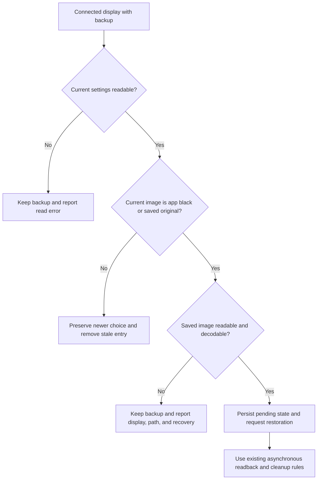

# Missing Desktop Wallpaper Recovery - Plan

> Superseded by the user's decision on 2026-11-12 to remove automatic desktop-wallpaper changes entirely because image restoration does not preserve aerial video selections.
> Retained as historical context, not as current implementation instructions.

## Goal Capsule

- **Objective:** Users can recover from a missing original wallpaper without losing their saved settings or having another display's restoration blocked.
- **Means:** Validate original image files and explain recovery through the existing desktop wallpaper controller (KTD1–KTD3).
- **Authority:** Product requirements govern behavior; technical decisions govern implementation within those requirements. Repository instructions govern Git operations and verification.
- **Execution:** One bounded fix, suitable for one PR. Implementation and local verification are authorized on `fix/missing-desktop-wallpaper`; leave changes uncommitted. Publication and installation require separate permission.
- **Stop conditions:** Do not change the user's actual wallpaper or backup data, silently select a fallback, weaken backup retention, or claim exact aerial restoration.

## Product Contract

### Summary

Prevent Matrix Wallpaper from replacing an original image it cannot read, and make existing missing-file restoration failures actionable.
Keep the original backup until restoration succeeds or the user chooses another wallpaper.

### Problem Frame

The reported restore alert says only “The file doesn’t exist” and promises another retry.
Read-only inspection found the built-in display's saved original points to a deleted `wallpaper-debug/live-state/black.png` in temporary storage.
The connected external display entries inspected point to an existing, decodable macOS default wallpaper image.
The user recalls one black display and macOS aerial wallpapers on the others; the missing temporary file does not establish what the built-in display originally displayed.

The controller persists image URLs and options, but currently checks only that a URL is a file URL before changing the desktop.
Restoration passes the saved URL to AppKit without checking the file and forwards AppKit's generic error to the existing alert.
Retry alone cannot recover a deleted file.

### Requirements

**Safe acquisition and restoration**

- R1. Before backing up a newly acquired original and replacing its desktop with black, require a readable local image that AppKit can decode. An invalid original leaves that display and its existing backup untouched.
- R2. Before restoring an app-owned desktop, reject a missing or undecodable saved image without invoking the desktop setter or deleting its backup.
- R3. Invalid images on one display must not prevent attempts on the other connected displays. Continue reporting the first failure, matching the existing controller contract.
- R4. Preserve original image URLs, options, pending-restore semantics, disconnected entries, and retry behavior for valid originals. Do not migrate the backup format or copy original images into app storage.

**Recovery and diagnostics**

- R5. A missing/unreadable-image error identifies the affected display and image path, and tells the user to select a replacement in System Settings > Wallpaper, then choose Quit Matrix Wallpaper. Quit remains available after a failed Stop has changed its menu item to Start Wallpaper.
- R6. A newer wallpaper selection takes precedence over a stale backup, even when the saved original is missing. Stop preserves the newer choice and removes only that display's stale entry.
- R7. Failed restores keep their backup available for a later retry, including after relaunch. If the original file becomes readable again, the existing restore operation can succeed.

### Acceptance Examples

- AE1. **Covers R1, R3.** Start with one missing original and one valid image: the first display is not changed or newly backed up; the second can become black.
- AE2. **Covers R2, R3, R5, R7.** Delete an original after Start, then Stop: that display remains unchanged, its backup survives, another valid display restores, and the error names the failed display and recovery action.
- AE3. **Covers R6.** After AE2, select another wallpaper and quit while playback is stopped: no restore write overwrites the selection, and its stale entry is cleared.
- AE4. **Covers R4, R7.** Restore the missing original file and retry with a fresh controller: the image and native options round-trip successfully.

### Scope Boundaries

- This is a file-based restoration safety fix, not a new wallpaper manager or repair wizard.
- Do not delete the observed live backup, recreate its temporary file, or choose an aerial/black fallback automatically. The original choice is unknown.
- Preserve the existing native alert and its suppression behavior; no new alert buttons, automatic retries, filesystem watchers, or settings are needed.
- Exact animated aerial, rotating collection, per-Space, and color-only restoration remain outside the image-based API's supported round-trip guarantee.
- Do not edit `README.md` without separate permission. Developer documentation may describe the validation and recovery behavior.
- Do not add dependencies or change packaging, screen saver rendering, installation scripts, CI, or preference storage.

## Planning Contract

### Repository Evidence

- `Sources/MatrixWallpaper/DesktopWallpaperController.swift`: `start()` saves before changing desktops; `restore()` handles each display independently and lets newer image URLs supersede backups.
- `Sources/MatrixWallpaper/WallpaperApp.swift`: `updateDesktopWallpaper(restoring:)` presents the controller's localized error and states that backups remain available. Controller errors can carry the new recovery detail without changing the alert UI.
- `Tests/MatrixWallpaperTests/DesktopWallpaperTests.swift`: the existing fixture owns isolated persistence but currently supplies nonexistent synthetic image paths. Its setter does not validate files, so the missing-file gap is not covered.
- `Tests/MatrixWallpaperTests/WallpaperAppTests.swift` compares those synthetic paths in lifecycle checks. `LoginItemTests.swift` and `ScreenSaverInstallationTests.swift` also construct the fixture.
- The original restoration work is [PR #108](https://github.com/patrickschaper/matrixScreenSaver/pull/108); its URL-and-options storage and no-overwrite rules remain intact.

### Key Technical Decisions

- KTD1. **Validate in the shared controller, not only the system setter.** Use one small local-image validation helper from acquisition and owned restoration. Check local readability and AppKit image validity so injected desktop operations exercise the same decisions as production.
- KTD2. **Keep ownership checks before restore validation.** R6 must work even if the saved file is missing; a newer user choice is not a reason to validate or rewrite the old image. Retain the existing equality and asynchronous visibility checks.
- KTD3. **Reuse the current error and alert path.** Resolve a connected display's human-readable name from the existing UUID lookup, falling back to its ID in isolated tests. Include the path and R5 recovery guidance in the localized description. Do not introduce an error hierarchy or new UI.
- KTD4. **Use real image fixtures without real desktop operations.** Create tiny PNG originals and replacements in an isolated fixture-owned directory, separate from the controller's storage directory. Keep storage absent initially so corrupt/unwritable-storage tests retain their meaning. Update lifecycle assertions to compare fixture URLs rather than root-level fake paths.
- KTD5. **Do not promise permanence after preflight.** A file may disappear after validation or AppKit may reject a valid image. Preserve existing setter-error handling and retain recoverable backups; preflight is not an atomic guarantee.

### Restore Decision Flow

## Implementation Units

### U1. Establish real-image regression fixtures

**Goal:** Make the missing-file failure reproducible through the existing test seam.

**Covers:** R1–R7; KTD4. **Dependencies:** none.

**Files:** `Tests/MatrixWallpaperTests/DesktopWallpaperTests.swift`, `Tests/MatrixWallpaperTests/WallpaperAppTests.swift`.

**Approach:** Generate fixture-owned PNGs and use explicit original/replacement URLs in existing assertions. Add regression tests before changing the controller. Keep fake screen discovery, reads, and writes; never call the real desktop setter.

**Test scenarios:**

- Existing original-image/options round trips, delayed writes, relaunch, disconnected screens, and storage failures still use valid originals and retain their current expectations.
- Covers AE1: an absent original cannot trigger a write or new backup for its display.
- A readable file containing non-image data and a directory URL are rejected like a missing image.
- Covers AE2: a saved original deleted after acquisition produces an actionable error, retains its entry, and does not block a healthy display's restore.
- Covers AE3 and AE4: selecting a different URL clears the stale entry, while restoring the original file permits a fresh-controller retry. Add an app lifecycle check that quitting a stopped host preserves the replacement and clears the stale backup.
- A failed desktop setter after successful validation still leaves a recoverable backup.

**Test seam:** These tests cover real file validation, persistence, and controller decisions; fake desktop operations do not prove macOS aerial selection or live AppKit restoration.

**Verification:** The new missing-image assertions fail against the original controller for the expected behavior, not fixture setup errors. Existing lifecycle checks remain meaningful.

### U2. Add validation and actionable restoration failures

**Goal:** Satisfy the safety and recovery requirements through the existing controller.

**Covers:** R1–R7; KTD1–KTD3, KTD5. **Dependencies:** U1.

**Files:** `Sources/MatrixWallpaper/DesktopWallpaperController.swift`, `Tests/MatrixWallpaperTests/DesktopWallpaperTests.swift`.

**Approach:**

1. Validate the candidate original before persisting a replacement entry or calling the black-image setter, including an original reused from pending restoration.
2. Validate a saved original only inside the existing owned-restore branch, before persisting new pending state or calling the setter.
3. Produce R5 diagnostics through the existing error factory. Preserve per-display continuation and existing persistence/error handling.
4. Add DocC purpose and parameter/failure documentation for every changed declaration.

**Test scenarios:** U1 scenarios pass; a pending invalid original cannot be recommitted on immediate Start; a user-selected replacement is preserved without consulting the invalid old file.

**Test seam:** The controller tests enforce preflight and recovery decisions but cannot prove system acceptance after validation or remove file-deletion races.

**Verification:** Regression, delayed restoration, app lifecycle, and fixture consumers pass without changing the backup schema or alert presentation.

### U3. Document and verify the bounded fix

**Goal:** Explain the failure/recovery contract and prove both products still build.

**Covers:** R4–R7. **Dependencies:** U2.

**Files:** `docs/development.md`; existing test runners and build scripts are verification inputs, not expected edits.

**Approach:** Add the validation and missing-file recovery behavior to the desktop lifecycle section. Review the diff for documentation coverage and unrelated changes. Keep all live wallpaper operations out of automated checks.

**Test expectation:** No new test for documentation. Reuse U1–U2 coverage and the existing application/saver suites.

**Verification:** Follow the Verification Contract and report unperformed manual checks explicitly.

## Verification Contract

- Run `./wallpaper-tests.sh`: new regression checks and existing application, installation, login, and consumer-host checks pass with isolated desktop state.
- Run `./tests.sh`: shared screen saver behavior remains unchanged.
- Run `./build.sh` and `./build-wallpaper.sh --saver build/MatrixScreenSaver.saver`: both native products compile and retain existing packaging/signing behavior.
- Run `git diff --check` and inspect changed declarations for required Swift documentation.
- Never run an installer, edit the live `originals.plist`, or exercise the real desktop setter for this task.
- Manual follow-up, requiring separate authorization: verify the actual alert identifies the display/path; choose a replacement in System Settings; Quit preserves it and clears the stale entry even after playback has stopped. Check live aerial/color-only behavior separately before claiming support.

## Definition Done

- Invalid originals cannot cause a new black-desktop replacement or a restore setter call.
- Missing-file failures include enough information to recover, and backups remain intact until success or a newer user choice.
- Valid displays, delayed restore visibility, pending Start/Stop transitions, and relaunch recovery retain their existing behavior.
- Existing and new isolated checks pass, both products build, and changed declarations have accurate documentation.
- No abandoned debugging code, dependencies, schema migrations, live preference changes, installation, commits, or publication are included.
- Remaining limits are explicit: lost originals cannot be reconstructed, validation does not prevent later file deletion, and exact aerial/color-only/Space restoration is not established.
